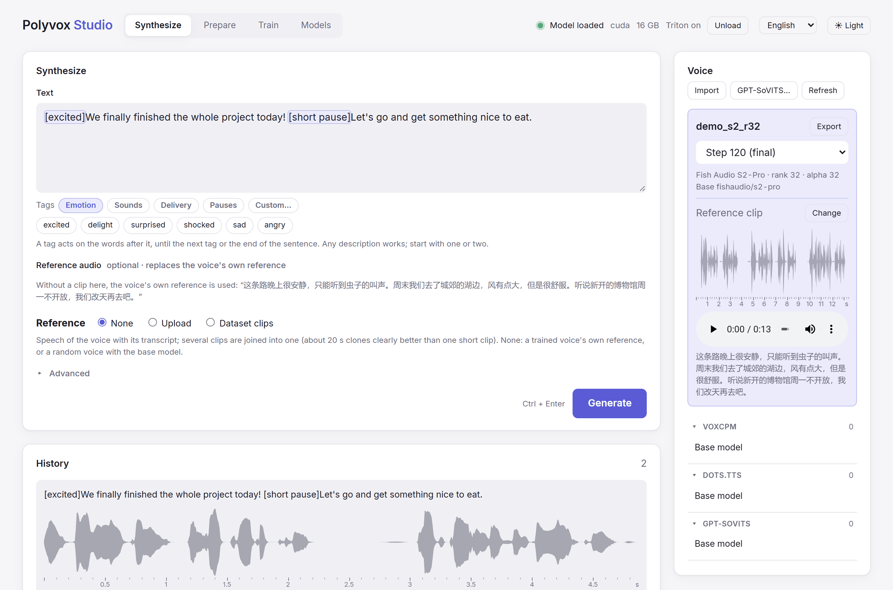
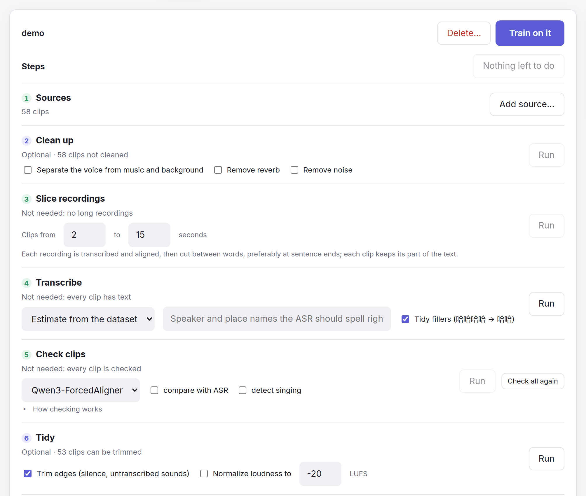
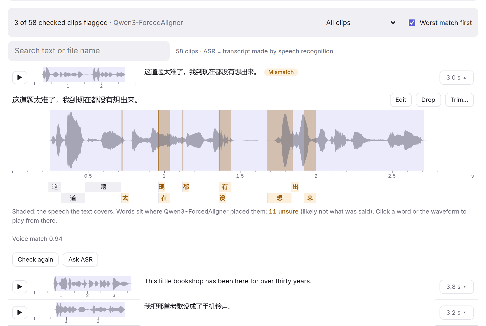
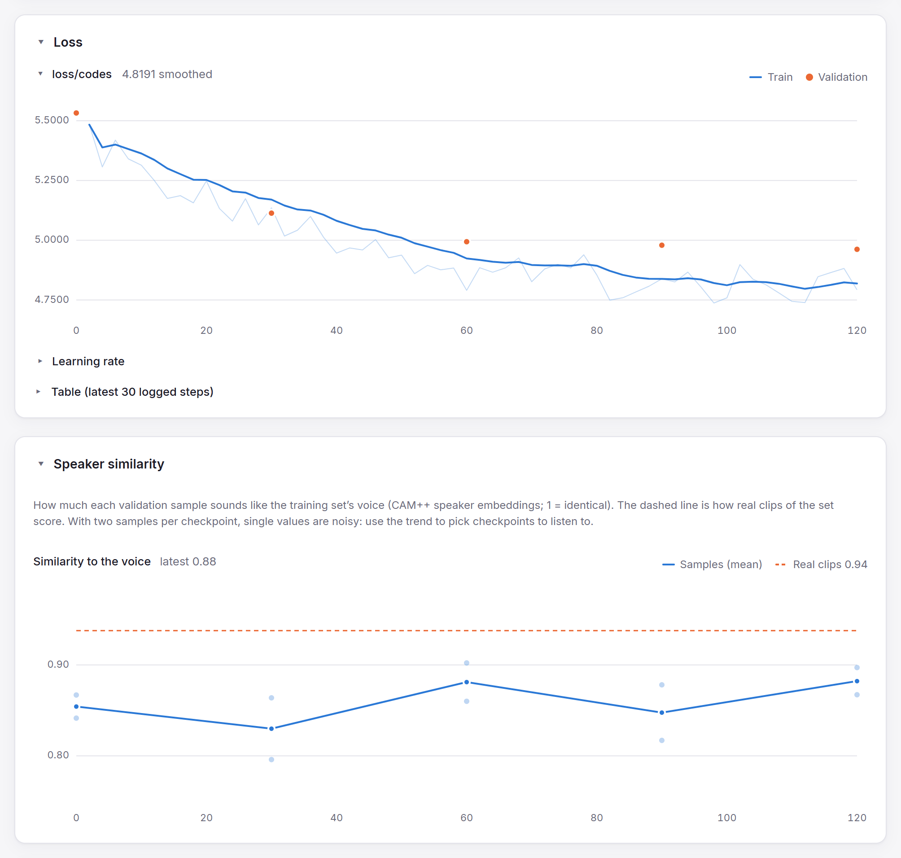

<div align="center">


# Polyvox Studio

**Train text-to-speech voices from your own recordings, and use them, all on your own computer.**


English | [简体中文](README_zh.md)

</div>

A web app that turns raw audio into a clean dataset, fine-tunes a voice on
[VoxCPM2](https://github.com/OpenBMB/VoxCPM),
[dots.tts](https://github.com/rednote-hilab/dots.tts),
[GPT-SoVITS](https://github.com/RVC-Boss/GPT-SoVITS) or
[Fish Audio S2-Pro](https://huggingface.co/fishaudio/s2-pro), and speaks with it.



## ✨ Highlights

- 🎙️ **Four TTS models, one workflow.** VoxCPM2, dots.tts, GPT-SoVITS (v2Pro,
  v2ProPlus, v4) and Fish Audio S2-Pro. Prepare a dataset once and train any of
  them.
- ✂️ **Raw recordings in, clean dataset out.** Hours of audio, even m4a or video
  files, are cut into clips between words and transcribed automatically. Music,
  reverb and noise can be removed.
- 🔍 **Bad clips found for you.** Wrong transcripts, cut-off words, other speakers,
  distortion and singing are flagged, so you only review what needs it.
- 📈 **See how training goes.** Loss charts, audio samples and a "sounds like the
  speaker" score at every checkpoint.
- ⚡ **Faster than the original code, same quality.** Synthesis up to 4x faster,
  training steps up to 3x, and switching voices takes about a second.
- 🎛️ **Fits your GPU.** Settings for 8, 12 and 16 GB cards are picked for you.
- 🤝 **GPT-SoVITS compatible.** Bring the voices you trained in its webui; voices
  trained here work there too.
- 📦 **Easy to install.** One command, no Python or FFmpeg setup. Windows and
  Linux; interface in English and 简体中文.

## 🧭 How it works

<table>
  <tr>
    <td width="40%" valign="top">
      <b>1. Prepare</b><br />
      Create a dataset, add a folder of recordings or a transcript list, and
      run the steps. Each step shows what still needs it and works only on
      that.
    </td>
    <td></td>
  </tr>
  <tr>
    <td valign="top">
      <b>2. Review</b><br />
      Fix or drop the clips it flags, worst first. Every word sits where the
      aligner placed it; the ones it doubts are marked.
    </td>
    <td></td>
  </tr>
  <tr>
    <td valign="top">
      <b>3. Train</b><br />
      Pick a model and start. Listen to the samples as checkpoints arrive;
      the similarity chart shows which sound most like the speaker.
    </td>
    <td></td>
  </tr>
</table>

**4. Synthesize:** choose your voice, type, and generate (the screenshot at the top).

## ⚡ Speed

Optimized paths written for this studio, checked against the original code for
the same results:

| | Faster by |
|---|---|
| 🗣️ dots.tts synthesis | **~4x** |
| 🗣️ GPT-SoVITS synthesis | **~2.5x** |
| 🔁 Switching voices (VoxCPM2, dots.tts) | **~1 s** instead of a 30-40 s reload |
| 🏋️ dots.tts training | **~3x** per step |
| 🏋️ VoxCPM2 training | **~1.6x** per step, half the GPU memory |

How each is done, and more numbers, in the [guide](docs/GUIDE.md#speed).

## 🚀 Quick start

1. Install [uv](https://docs.astral.sh/uv/):

   ```powershell
   powershell -ExecutionPolicy ByPass -c "irm https://astral.sh/uv/install.ps1 | iex"   # Windows
   curl -LsSf https://astral.sh/uv/install.sh | sh                                       # Linux
   ```

2. Download the [latest release](../../releases/latest) (`.zip` for Windows,
   `.tar.gz` for Linux), unpack it and run `run.bat` or `./run.sh`. The first
   start installs everything, which takes a few minutes.
3. Open http://127.0.0.1:8808 and download **VoxCPM2** in the **Models** tab.
4. Type something in **Synthesize** and press **Generate**. 🎉

## 💻 Requirements

- 🖥️ Windows or Linux.
- 🎮 An NVIDIA GPU with 8 GB of memory or more; 16 GB trains at full speed and
  is needed for S2-Pro. AMD GPUs on Linux should work but are untested. Without a
  GPU you can only prepare datasets.
- 💾 Disk space for models: about 5 GB per TTS model (S2-Pro 11 GB), plus about
  6 GB for the dataset tools (speech recognition and alignment).

## 📖 Learn more

The [guide](docs/GUIDE.md) covers each step in depth: dataset preparation and
the clip checks, training options, the speed optimizations and their
measurements, models, configuration and development.

## 📄 License

[Apache-2.0](LICENSE). Polyvox Studio includes code from other projects under their own
licenses; see [third-party notices](THIRD_PARTY_NOTICES.md).

Models downloaded in the Models tab keep their own licenses, shown there. Fish Audio
S2-Pro's weights, and voices trained on them here, are for research and
non-commercial use only (Fish Audio Research License).
