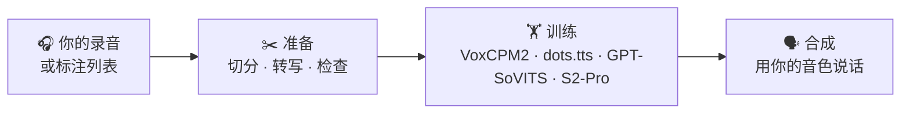

<div align="center">


# Polyvox Studio

**用你自己的录音训练语音合成音色并直接使用，全部在你自己的电脑上完成。**


[English](README.md) | 简体中文

</div>

一个网页应用：把原始音频整理成干净的数据集，在
[VoxCPM2](https://github.com/OpenBMB/VoxCPM)、
[dots.tts](https://github.com/rednote-hilab/dots.tts)、
[GPT-SoVITS](https://github.com/RVC-Boss/GPT-SoVITS) 或
[Fish Audio S2-Pro](https://huggingface.co/fishaudio/s2-pro) 上微调音色，再用它说话。

## ✨ 亮点

- 🎙️ **四种 TTS 模型，一套流程。** VoxCPM2、dots.tts、GPT-SoVITS（v2Pro、v2ProPlus、v4）和
  Fish Audio S2-Pro。数据集准备一次，就能训练任意一种模型。
- ✂️ **放进原始录音，得到干净的数据集。** 几个小时的音频（m4a、视频文件也可以）会自动在词与词之间
  切成片段并转写成文字；还可以去除音乐、混响和噪声。
- 🔍 **自动找出有问题的片段。** 文本写错、字被截断、混进别人的声音、失真和唱歌都会被标记出来，
  只需审阅需要处理的部分。
- 📈 **训练过程看得见。** 每个检查点都有损失曲线、试听样本和“像不像本人”的评分。
- ⚡ **比原始代码更快，质量不变。** 合成最多快 4 倍，训练每步最多快 3 倍，切换音色只需约 1 秒。
- 🎛️ **适配你的显卡。** 自动为 8、12、16 GB 显存选择合适的设置。
- 🤝 **兼容 GPT-SoVITS。** 可以导入在 GPT-SoVITS 网页界面中训练的音色；在这里训练的音色也能在那边使用。
- 📦 **安装简单。** 一条命令，无需配置 Python 或 FFmpeg。支持 Windows 和 Linux，界面有简体中文和英文。

## 🧭 使用流程



1. **准备**：新建数据集，添加一个录音文件夹或标注列表，运行各个步骤。修正或删除被标记的片段。
2. **训练**：选择模型并开始。检查点陆续生成时试听样本，留下听起来最好的那个。
3. **合成**：选择你的音色，输入文字，生成。

## ⚡ 速度

为本项目专门优化的实现，并与原始代码对照验证过，结果一致：

| | 提升 |
|---|---|
| 🗣️ dots.tts 合成 | **约 4 倍** |
| 🗣️ GPT-SoVITS 合成 | **约 2.5 倍** |
| 🔁 切换音色（VoxCPM2、dots.tts） | **约 1 秒**，而不是 30–40 秒的重新加载 |
| 🏋️ dots.tts 训练 | 每步**约 3 倍** |
| 🏋️ VoxCPM2 训练 | 每步**约 1.6 倍**，显存减半 |

具体做法和更多数据见[使用指南](docs/GUIDE.md#speed)（英文）。

## 🚀 快速开始

1. 安装 [uv](https://docs.astral.sh/uv/)：

   ```powershell
   powershell -ExecutionPolicy ByPass -c "irm https://astral.sh/uv/install.ps1 | iex"   # Windows
   curl -LsSf https://astral.sh/uv/install.sh | sh                                       # Linux
   ```

2. 下载[最新版本](../../releases/latest)（Windows 用 `.zip`，Linux 用 `.tar.gz`），解压后运行
   `run.bat` 或 `./run.sh`。首次启动会安装所有依赖，需要几分钟。
3. 打开 http://127.0.0.1:8808 ，在「模型」页下载 **VoxCPM2**。在中国大陆可以在该页选择
   hf-mirror.com 镜像。
4. 在「合成」页输入文字，点击「生成」。🎉

## 💻 运行要求

- 🖥️ Windows 或 Linux。
- 🎮 8 GB 及以上显存的 NVIDIA 显卡；16 GB 可以全速训练，S2-Pro 需要 16 GB。Linux 上的 AMD 显卡
  应该可用，但未经测试。没有显卡时只能准备数据集。
- 💾 模型所需磁盘空间：每个 TTS 模型约 5 GB（S2-Pro 11 GB），数据集工具（语音识别和对齐）另需约 6 GB。

## 📖 了解更多

[使用指南](docs/GUIDE.md)（英文）详细介绍每个步骤：数据集准备与片段检查、训练选项、速度优化及
实测数据、模型、配置和开发。

## 📄 许可证

[Apache-2.0](LICENSE)。Polyvox Studio 包含来自其他项目的代码，它们遵循各自的许可证，见
[第三方声明](THIRD_PARTY_NOTICES.md)（英文）。

在「模型」页下载的模型遵循各自的许可证（页面上有标注）。Fish Audio S2-Pro 的权重，以及在这里基于它
训练的音色，仅限研究和非商业用途（Fish Audio Research License）。
